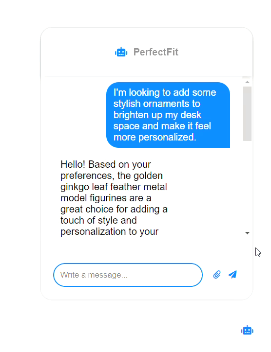
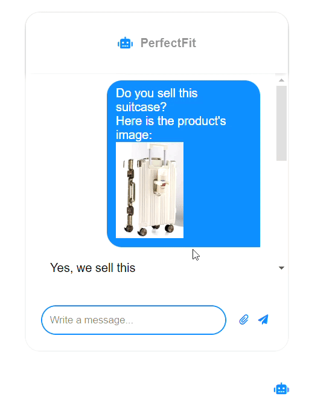

# PerfectFit

We present to you – PerfectFit, your AI shopping assistant for online buying experience. If you've ever found yourself feeling overwhelmed by the endless product options on e-commerce sites, or unsure if a specific product exists, PerfectFit is here to make your shopping experience simpler, faster, and more intuitive.

## 🎯 What is PerfectFit?
Using your description and/or an image of what you are searching for, PerfectFit understands what you want and searches the catalog to find the suitable product in seconds. Say goodbye to the tedious scrolling or guesswork — PerfectFit instantly finds your requirements and quickly aligns them with the best recommendations for all the things you want, ensuring you are always matched stripe for stripe with what you seek. Multimodal by design, PerfectFit provides a seamless experience of text-based product search and visual search.

## 🚀 Key Features & Benefits
- Find Your Fit with Ease: Describe what you need, and PerfectFit’s AI will recommend the ideal products – no matter how unique your request might be.
- Visual Search: Got an image of what you’re after? Upload it, and PerfectFit will locate the closest matches from the available products, saving you time and effort.

## 🛠️ How it works

```
 shopper: text and/or photo
        │
        ▼
 1. Understand ── vision-language model (Qwen3-VL via Ollama, structured JSON output)
        │          → search text, item type, colour, gender, price range
        │          → item type mapped to a real catalog category by embedding similarity
        ▼
 2. Search ────── Qdrant hybrid search, fused with Reciprocal Rank Fusion
        │          • dense text vectors (BGE)        • BM25 keywords
        │          • SigLIP 2 image vectors, queried with the text AND the uploaded photo
        │          • exact filters on category / colour / gender / price / size,
        │            relaxed one by one if nothing matches
        ▼
 3. Answer ────── same model picks matching products (or honest alternatives) and writes the reply
        │
        ▼
 answer + product cards
```

- **One local model, no API keys.** A single vision-language model understands photos, parses the request and writes the answer. Everything runs on your machine.
- **Image search is real image search.** An uploaded photo is embedded with SigLIP 2 and compared with product photos directly, instead of being turned into a caption first.
- **Hybrid retrieval with filters.** Semantic vectors catch "something for a summer wedding", BM25 catches brand names and exact words, and filters make "black, for men, under 50 €" actually hold.
- **Grounded answers.** The model only sees real candidates, and the server drops any product id it did not retrieve. If the store doesn't have something, PerfectFit says so and offers the closest items, or nothing at all.
- **Lightweight.** Embeddings run on CPU through FastEmbed (ONNX), with no PyTorch install.

## 🎥 Demo

| **Demo 1: Text-based Search** | **Demo 2: Hybrid search (Product Exists)** | **Demo 3: Hybrid Search (Product Doesn't Exist)** |
|:-----------------------------:|:-------------------------:|:----------------------------:|
|   |  |  |

## 🌐 Getting Started

**1. Install**
```bash
git clone https://github.com/imane0x/PerfectFit.git
cd PerfectFit
python -m venv .venv && source .venv/bin/activate
pip install -r requirements.txt
cp .env.example .env
```

**2. Start Ollama and pull the model** (install Ollama from [ollama.com/download](https://ollama.com/download))
```bash
ollama pull qwen3-vl:4b-instruct      # ~3 GB, runs on a 6 GB GPU; use qwen3-vl:8b-instruct if you have more
```
Use an *instruct* model: thinking variants ignore the JSON output format.

**3. Get a catalog and index it**
```bash
python scripts/download_sample.py --count 400   # sample from the public Fashion Product Images dataset
python ingest.py                                # the first run downloads the embedding models (~2 GB)
```

**4. Run**
```bash
flask run
```
Open http://127.0.0.1:5000. To try it from the terminal: `python chat.py`, or `python scripts/smoke_test.py` for a set of example queries.

### Use your own catalog
`products.jsonl`, one product per line. Only `id`, `title` and `image` are required; image paths are relative to the file.
```json
{"id": "sku-123", "title": "Linen Summer Dress", "image": "images/sku-123.jpg", "description": "Lightweight midi dress...",
 "category": "Dresses", "color": "White", "gender": "Women", "price": 59.9, "currency": "EUR",
 "sizes": ["S", "M", "L"], "url": "https://shop.example.com/sku-123"}
```
Point `PERFECTFIT_CATALOG` at it and re-run `python ingest.py`. Re-running always rebuilds the index.

### With Docker
```bash
cp .env.example .env
python scripts/download_sample.py
docker compose up -d ollama && docker compose exec ollama ollama pull qwen3-vl:4b-instruct
docker compose run --rm app python ingest.py
docker compose up app
```

### Tests
```bash
pip install -r requirements-dev.txt
pytest
```
The tests use stub embeddings, an in-memory Qdrant and a stub model, so they run in about a second with no GPU or downloads.

## ⚙️ Configuration
All settings live in `.env` (see `.env.example`): catalog path, Ollama model and URL, upload size limit. Retrieval knobs are in `src/config.py`.

## 📦 Sample data
`scripts/download_sample.py` fetches products from [ashraq/fashion-product-images-small](https://huggingface.co/datasets/ashraq/fashion-product-images-small) on Hugging Face (originally the Kaggle "Fashion Product Images" dataset). The data is downloaded locally and is not part of this repository. That dataset has no prices or sizes, so those filters only apply to catalogs that include them.
