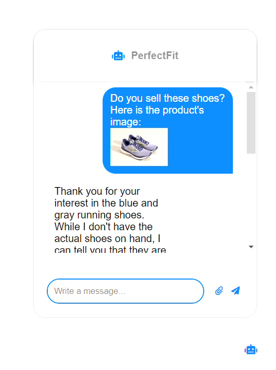

# PerfectFit

We present to you – PerfectFit, your AI shopping assistant for online buying experience. If you've ever found yourself feeling overwhelmed by the endless product options on e-commerce sites, or unsure if a specific product exists, PerfectFit is here to make your shopping experience simpler, faster, and more intuitive.

## 🎯 What is PerfectFit?
Using your description and/or an image of what you are searching for, PerfectFit asks you several questions before using its AI-assisted intelligent swatch chooser to find the suitable product in seconds. Say goodbye to the tedious scrolling or guesswork — PerfectFit instantly finds your requirements and quickly aligns them with the best recommendations for all the things you want, ensuring you are always matched stripe for stripe with what you seek. Multimodal by design, PerfectFit provides a seamless experience of text-based product search and visual search.

## 🚀 Key Features & Benefits
- Find Your Fit with Ease: Describe what you need, and PerfectFit’s AI will recommend the ideal products – no matter how unique your request might be.
- Visual Search: Got an image of what you’re after? Upload it, and PerfectFit will locate the closest matches from the available products, saving you time and effort.

## 🛠️ How it works

```
 text / image ──► Flask /predict ──► (image? caption it: Gemini or local VLM)
                                          │
                                          ▼
                      Qdrant (local)  ◄── retrieve: BGE text vectors + CLIP image vectors
                                          │
                                          ▼
                     Vision-language model (Ollama) answers, sees the retrieved product image
                                          │
                                          ▼
                       answer + best-matching product image (if the match is confident)
```

- **Retrieval:** product descriptions are embedded with `BAAI/bge-large-en-v1.5`, product images with CLIP, both stored in a local Qdrant database.
- **Answering:** a vision-language model served by [Ollama](https://ollama.com) (`llava` by default, any Ollama vision model works) writes the reply from the retrieved products.
- **Image uploads:** captioned by Gemini when `GOOGLE_API_KEY` is set, otherwise by the same local model, so the app runs fully offline.
- The index is built once by `ingest.py`; the server loads models and index a single time at the first request.

## 🎥 Demo

| **Demo 1: Text-based Search** | **Demo 2: Hybrid search (Product Exists)** | **Demo 3: Hybrid Search (Product Doesn't Exist)** |
|:-----------------------------:|:-------------------------:|:----------------------------:|
|   |  |  |

## 🌐 Getting Started

**1. Install**
```bash
git clone https://github.com/imane0x/PerfectFit.git
cd PerfectFit
python -m venv .venv && source .venv/bin/activate
pip install -r requirements.txt
cp .env.example .env
```

**2. Start Ollama and pull a vision model** (install it from [ollama.com/download](https://ollama.com/download))
```bash
ollama pull llava
```

**3. Add your catalog and index it**

Put product images (`.jpg`, `.png`, ...) and description files (`.txt`, `.md`, `.csv`, ...) in `data/catalog/`, then:
```bash
python ingest.py            # or: python ingest.py path/to/catalog
```
Re-running `ingest.py` rebuilds the index from scratch.

**4. Run**
```bash
flask run
```
Open http://127.0.0.1:5000.

### With Docker
```bash
cp .env.example .env
docker compose up -d ollama && docker compose exec ollama ollama pull llava
docker compose run --rm app python ingest.py
docker compose up app
```

### Tests
```bash
pip install -r requirements-dev.txt
pytest
```
The tests use stubs for the models, so they run in under a second with no GPU.

## ⚙️ Configuration
All settings live in `.env` (see `.env.example`): catalog path, Ollama model and URL, optional Gemini key, match threshold, upload size limit.
